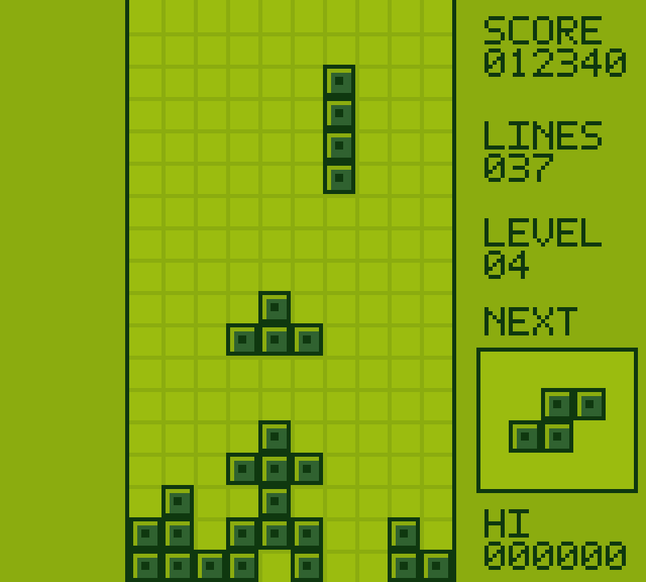
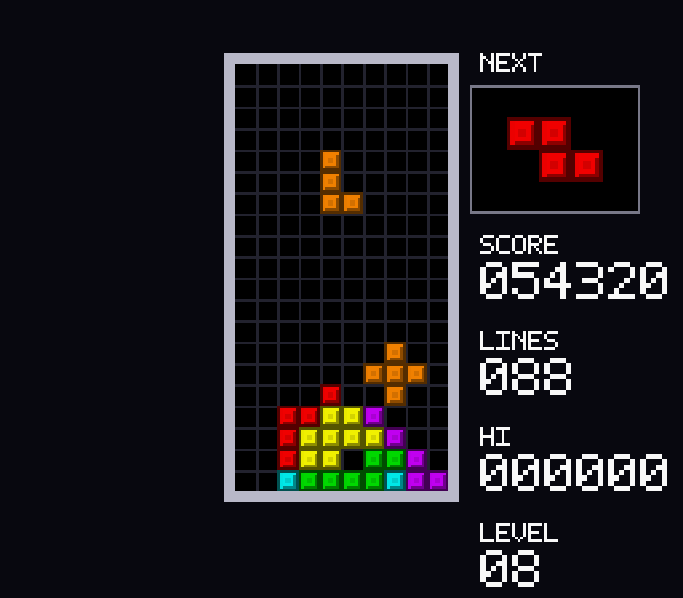

# Bird Blocks

[](https://github.com/felippeb/birdblocks-forever/actions/workflows/ci.yml)

Game Boy and NES Tetris, playable **on the flight-path bird** in **WoW Forever**
(interface `16001`, game version `1.60.1`).

Get on a taxi, and the handheld opens by itself ready to play. Land, and it closes.
No buttons, no menus, no addon config to learn.



## What it is

A real, from-scratch Tetris clone for Forever — not a skin over something else.
No wall kicks, no lock delay, no hold, no hard drop. Two faithful profiles:

| | **Game Boy** | **SNES / NES** |
| --- | --- | --- |
| Screen | 160×144, four shades of green | 256×224, colored pieces |
| Field | 10×18 | 10×20 |
| Gravity | 53 frames/row at level 0 | 48 frames/row at level 0 |
| DAS / ARR | 24 / 6 frames | 16 / 6 frames |
| ARE | 2 frames | 12 frames |
| Rotation | left-handed (Nintendo) | right-handed (Nintendo) |
| Scoring | 40 / 100 / 300 / 1200 × (level + 1) | same |
| Levels | 0–20 | 0–29 |

Everything advances in **60 Hz frames**, using the real frame tables from the
originals rather than approximations in seconds. The randomizer rerolls while the
piece matches the previous one, so no piece appears twice in a row — the small
rule that gives the original its feel.



## Controls

| Key | Action |
| --- | --- |
| ← → | Move (DAS then auto-shift) |
| ↓ | Soft drop (+1 per cell) |
| ↑ / X / W | Rotate |
| Z / Ctrl | Rotate the other way |
| Enter / Space | Start, or restart after game over |
| P / Esc | Pause (Esc closes when already paused) |
| M | Music on/off |
| Mouse wheel | Zoom |

The window is movable (drag the title bar). Arrow keys and the mouse wheel are
consumed while it is open, so nothing leaks to the world.

## Taxi behaviour

- Opens **1.5 s** after `UnitOnTaxi("player")` becomes true, and starts a game
  immediately — Enter also works, it is not a title-screen stop.
- Closes **2 s** after the flight ends.
- Closes instantly in combat and reopens when combat ends if you are still flying.
- Leaving the game paused (or closing it) stops the music; nothing plays on the ground.
- `/blocks auto` turns the automatic behaviour off entirely.

## Install

1. Download the latest zip from [Releases](../../releases).
2. Extract it so that `Interface\AddOns\BirdBlocks\` exists.
3. Restart the client — new folders are only read at startup.
4. After editing any `.lua`, `/reload` is enough.

The addon is also on CurseForge.

## Commands

```text
/blocks                 open or close
/blocks gb | snes       pick the version
/blocks auto            auto-open on taxi on/off
/blocks music | sound   toggle audio
/blocks zoom N          1..8, 0 = fit the screen
/blocks level N         starting level 0..9
/blocks reset           clear high scores
/blocks help            summary
```

`/bb` is a shorter alias. High scores are kept per profile in `BirdBlocksDB`.

## Audio

All sound is synthesized by `tools/make_assets.py`: square/triangle/noise style
blips and an original arrangement of the public-domain folk tune *Korobeiniki*,
shipped as mono OGG Vorbis. No Nintendo samples or recordings are included.

## How it is built

| Path | What it does |
| --- | --- |
| `src/engine.lua` | Pure Lua game logic: frame tables, DAS, ARE, rotation, clears, scoring, top-out |
| `src/view.lua` | Layouts and palettes for both profiles |
| `src/render.lua` | Pooled quads from one 256×256 TGA atlas, NEAREST filtering |
| `src/sound.lua` | `PlaySoundFile` SFX, looped theme |
| `src/ui.lua` | Window, keyboard, taxi/combat, slash commands, SavedVariables |
| `tools/make_assets.py` | Regenerates the atlas, icon, SFX, music and generated Lua |

`src/generated_atlas.lua` and `src/generated_audio.lua` are generated; edit the
generator, not the output.

### Tests

```powershell
lua tests\run_engine.lua      # frame timings, DAS, scoring, rotation, top-out
lua tests\run_ui.lua          # addon against a mock client: taxi, combat, keys, slash
lua tests\run_stress.lua      # 20,000 randomised frames, invariant-checked
lua tests\screenshots.lua     # writes draw lists to tests\out
python tests\rasterize.py tests\out   # turns them into PNGs
```

The mock client (`tests/wow_mock.lua`) records every texture the renderer touches,
so the screenshots above are the same quad calls the game makes in game.

## Compatibility

Verified on WoW Forever `1.60.1` / interface `16001`. Uses only APIs already
present in that client (`UnitOnTaxi`, `PlaySoundFile`, `CreateFrame`,
`SetPropagateKeyboardInput`). Not affiliated with or endorsed by Blizzard
Entertainment, Nintendo, or CurseForge.

## License

MIT — see [LICENSE](LICENSE). *Tetris* is a trademark of Tetris Holding; this is
an independent, non-commercial homage with original code, art and audio. See
[NOTICE](NOTICE).
