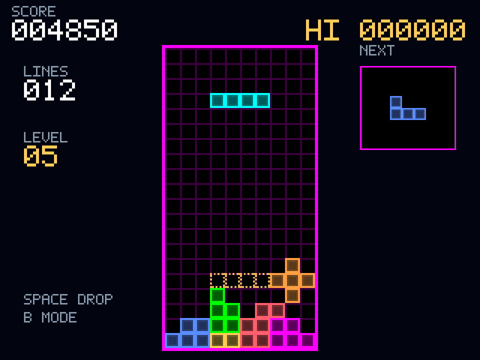
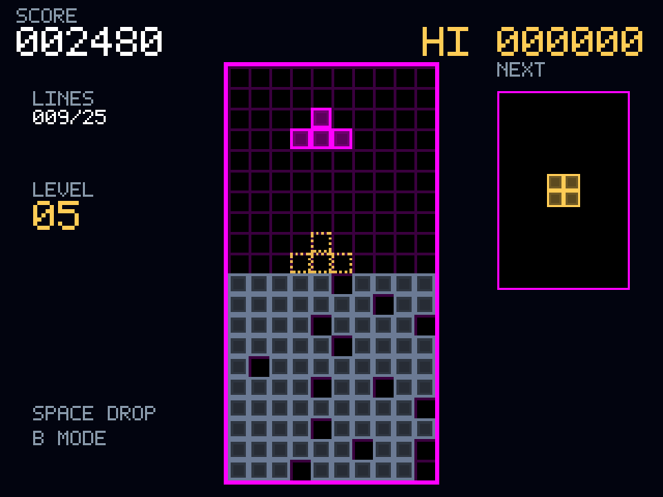

# Bird Blocks

[](https://github.com/felippeb/birdblocks-forever/actions/workflows/ci.yml)

Tetris, playable **on the flight-path bird** in **WoW Forever**
(interface `16001`, game version `1.60.1`).

Get on a taxi and it asks if you want to play; say yes and the game opens ready
to go. Land, and it closes. No buttons, no menus, no addon config to learn.



## What it is

A real, from-scratch Tetris clone for Forever — not a skin over something else.
Three rulesets share the same engine:

- **Modern** (default) — a neon arcade cabinet with guideline rules: SRS wall
  kicks, 7-bag randomiser, ghost piece, lock delay, hard drop and the modern
  scoring table. Hold and a three-piece preview are available in **normal** mode.
- **Game Boy** — 10×18, four shades of green, left-handed Nintendo rotation,
  no kicks, no lock delay.
- **SNES / NES** — 10×20, colored pieces, right-handed Nintendo rotation with
  the NES frame timings.

| | **Modern** | **Game Boy** | **SNES / NES** |
| --- | --- | --- | --- |
| Screen | 320×240 neon cabinet | 160×144, four greens | 256×224, colored |
| Field | 10×20 | 10×18 | 10×20 |
| Gravity | 16 frames/row at speed 5 | 33 frames/row at speed 5 | 23 frames/row at speed 5 |
| DAS / ARR | 10 / 1 frames | 24 / 6 frames | 16 / 6 frames |
| ARE | 4 frames | 2 frames | 12 frames |
| Rotation | SRS + wall kicks | left-handed Nintendo | right-handed Nintendo |
| Extras | ghost, hard drop, lock delay (hold in normal mode) | — | — |
| Scoring | 100 / 300 / 500 / 800 × (level + 1), T-spins, B2B, combos, perfect clears | 40 / 100 / 300 / 1200 × (level + 1) | same |
| Randomiser | 7-bag | no immediate repeat | no immediate repeat |
| Levels | 1–20 | 1–20 | 1–29 |

Everything advances in **60 Hz frames**. The retro profiles use the real frame
tables from the originals rather than approximations in seconds; the modern
profile uses the guideline timings.


## Speed

The game starts at **speed 5** — start level 5 — because level 0 is a museum
piece for anyone who has played Tetris before. Change it from the title screen
with ← →, or with `/blocks speed 1..10`. It is just the starting level, so the
score multiplier and level-ups work normally from there. `/blocks level` is kept
as an alias.

Speed applies to every profile; Game Boy and SNES still use their original
gravity, DAS and line-clear frame tables for the level you pick.

## Modes

Press **B** on the title screen to cycle, or pick one directly:

- **Classic** (default) — a clean well, **one piece of preview** and **no hold**.
  This is the handheld feel: you only ever see the piece that is coming next.
- **Normal** — the full modern cabinet: **three pieces of preview** and hold.
- **Broken** — the Game Boy's B-Type board, available in every profile. The well
  starts prefilled with junk rows up to **60%** of the field, and the run ends
  when you clear **25 lines**. Higher speeds start with a taller mess.

`/blocks classic | normal | broken`, or `/blocks mode` to cycle. Broken runs keep
their own high scores, so the garbage start does not pollute the clean table.



## Controls

| Key | Action |
| --- | --- |
| ← → | Move (DAS then auto-shift); on the title, pick speed |
| ↓ | Soft drop (+1 per cell) |
| ↑ / X / W | Rotate clockwise |
| Z / Ctrl | Rotate counter-clockwise |
| Space | Hard drop (+2 per cell, modern only) |
| C / Shift | Hold (normal mode only) |
| B | Cycle mode on the title screen |
| Enter | Start, or restart after game over |
| P | Pause / resume |
| Esc | Opens the client's game menu; the run pauses behind it |
| M | Music on/off |
| Mouse wheel | Zoom |

The window is movable (drag the title bar). Arrow keys and the mouse wheel are
consumed while it is open, so nothing leaks to the world — except **Esc**, which
is deliberately left to the client. The cabinet sits at `HIGH` frame strata and
hides itself while the game menu is open, so menus and dialogs are never covered
by it.

## Taxi behaviour

- **1.5 s** after `UnitOnTaxi("player")` becomes true, a dialog asks whether you
  want to play. **PLAY** opens the cabinet and starts a run; **NOT NOW** leaves
  it closed and nothing is played.
- No music until you say PLAY.
- Closes **2 s** after the flight ends.
- Closes instantly in combat and reopens when combat ends if you are still flying.
- One ask per flight: decline or close it mid-air and it stays quiet until the
  next taxi.
- Leaving the game, pausing, or closing the window stops the music.
- `/blocks auto` turns the automatic prompt off entirely; `/blocks prompt`
  toggles the dialog (with it off, the cabinet opens directly).

## Install

### WoWUp

Addons → **Install from URL** → `https://github.com/felippeb/birdblocks-forever`

WoWUp's Forever provider only accepts a release asset whose name ends in
`-forever.zip`, so the release zip is `BirdBlocks-<version>-forever.zip`.

### Manual

1. Download the latest zip from [Releases](../../releases).
2. Extract it so that `Interface\AddOns\BirdBlocks\` exists.
3. Restart the client — new folders are only read at startup.
4. After editing any `.lua`, `/reload` is enough.

Releases are published on GitHub. The CurseForge job is wired into the same tag
pipeline and starts uploading as soon as the project id is configured.

## Commands

```text
/blocks                 open or close
/blocks modern | gb | snes   pick the version
/blocks speed N         1..10 starting level, default 5
/blocks classic | normal | broken   select a mode
/blocks mode            cycle classic -> normal -> broken
/blocks prompt          ask before opening on a taxi
/blocks auto            auto-open on taxi on/off
/blocks music | sound   toggle audio
/blocks zoom N          1..8, 0 = fit the screen
/blocks reset           clear high scores
/blocks help            summary
```

`/bb` is a shorter alias. `/blocks level N` still works as an alias for speed.
High scores are kept per profile, with broken runs in their own table. Existing
installs adopt the modern profile once on upgrade; an explicit `/blocks gb` or
`/blocks snes` always wins. An old start level is migrated to the same speed.

## Audio

All sound is synthesized by `tools/make_assets.py`: square/triangle/noise style
blips and an original arrangement of the public-domain folk tune *Korobeiniki*,
shipped as mono OGG Vorbis. No Nintendo samples or recordings are included.

## How it is built

| Path | What it does |
| --- | --- |
| `src/engine.lua` | Pure Lua game logic: frame tables, DAS, ARE, SRS, 7-bag, hold, hard drop, lock delay, clears, scoring, top-out |
| `src/view.lua` | Layouts, palettes and effects for all three profiles |
| `src/render.lua` | Pooled quads from one 256×256 TGA atlas, NEAREST filtering |
| `src/sound.lua` | `PlaySoundFile` SFX, looped theme |
| `src/ui.lua` | Window, keyboard, taxi/combat, slash commands, SavedVariables |
| `tools/make_assets.py` | Regenerates the atlas, icon, SFX, music and generated Lua |

`src/generated_atlas.lua` and `src/generated_audio.lua` are generated; edit the
generator, not the output.

### Tests

```powershell
lua tests\run_engine.lua      # timings, DAS, SRS kicks, 7-bag, hold, scoring, garbage, goals
lua tests\run_ui.lua          # addon against a mock client: taxi, combat, keys, slash
lua tests\run_stress.lua      # 20,000 randomised frames, invariant-checked
lua tests\screenshots.lua     # writes draw lists to tests\out
python tests\rasterize.py tests\out   # turns them into PNGs
```

The mock client (`tests/wow_mock.lua`) records every texture the renderer touches,
so the screenshots above are the same quad calls the game makes in game.

## Publishing

The tag-driven pipeline (CI, CurseForge upload, GitHub release) is documented in
[docs/publishing.md](docs/publishing.md).

## Compatibility

Verified on WoW Forever `1.60.1` / interface `16001`. Uses only APIs already
present in that client (`UnitOnTaxi`, `PlaySoundFile`, `CreateFrame`,
`SetPropagateKeyboardInput`). Not affiliated with or endorsed by Blizzard
Entertainment, Nintendo, or CurseForge.

## License

MIT — see [LICENSE](LICENSE). *Tetris* is a trademark of Tetris Holding; this is
an independent, non-commercial homage with original code, art and audio. See
[NOTICE](NOTICE).
